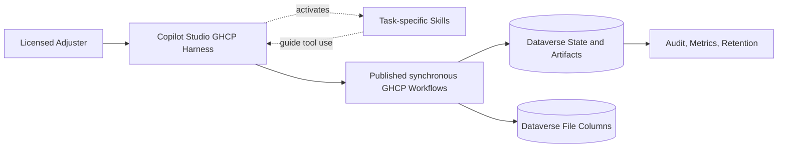

# TD CAT Contents Valuation - Copilot Studio GHCP Design

## Decision status

Design approved as the implementation baseline. Agent instructions, workflow specifications, and Skill packages are generated locally; Dataverse tables and executable GHCP Workflows still require tenant-side construction and testing.

**GHCP harness** means the generative orchestration runtime in Microsoft Copilot Studio. The runtime agent contains **no authored business topics** and initially targets Microsoft 365 Copilot.

Copilot Studio may retain platform-managed system artifacts, but they must not implement or control the valuation process.

## Design principles

1. The licensed adjuster remains the decision-maker for coverage, settlement, payment, denial, filing, and customer communication.
2. Copilot Studio generative orchestration owns workflow order and progression. It understands intent, reads the persisted case stage, asks for missing information, invokes the next action, handles holds, and resumes the process.
3. Dataverse is the durable process record. Each native GHCP Workflow independently enforces authorization, state preconditions, idempotency, concurrency, immutable inputs, and its permitted state transition.
4. Deterministic GHCP Workflows own file validation, parsing, research qualification, rules, calculations, quality gates, package generation, and approval recording. The model never performs these operations itself.
5. All durable state and artifacts live outside conversation history. A new conversation resumes from the persisted case checkpoint.
6. Every recommendation is visibly marked `UNAPPROVED RECOMMENDATION` until an authorized adjuster approves an immutable package version through the Package Review and Decision GHCP Workflows.

## Target architecture



Implement the deterministic capabilities as native Copilot Studio Workflows powered by the GitHub Copilot harness. Copilot Studio owns orchestration; each workflow validates its state precondition and fails closed when invoked out of order. No custom API, custom connector, Agent Flow, authored business topic, or MCP server is required.

Use Copilot Studio Skills for reusable, task-specific orchestration guidance. Skills instruct the runtime when and how to call workflow tools; they do not enforce security, calculate values, store state, or perform approval. The MVP uses `inventory-intake`, `valuation-review`, and `package-review-decision` Skills.

No child agent is required for the MVP. Research may later use a child agent only for discovery; it must return structured evidence, cannot message the user, and cannot update case state directly.

## Runtime orchestration without topics

The GHCP harness consists of:

- Generative orchestration enabled in agent settings.
- Agent instructions containing authority and tool-use invariants.
- Skills containing focused intake, valuation-review, and package-decision procedures.
- Published synchronous GHCP Workflow tools for every deterministic process step.
- Workflow descriptions that state exact preconditions and intended use.
- Inventory Intake and Package Review and Decision workflow capabilities.
- Workflow responses containing persisted state, `missingFields`, issues, artifacts, and authoritative display values.
- Dataverse and artifact storage as the sole source of resumable state.

For each user turn, GHCP loads the current Dataverse case, evaluates the persisted stage and unresolved issues against the ordered process, supplies only confirmed inputs, and invokes the next required workflow tool. The workflow accepts or rejects its permitted transition based on persistent state. GHCP records the returned stage, presents the result without recomputing it, and continues or holds as appropriate.

Copilot Studio instructions and workflow tool descriptions define workflow order. Workflow-level precondition, idempotency, and version checks ensure an incorrect, duplicate, or stale invocation cannot corrupt durable state.

## Authority boundary

GHCP may:

- Open or resume an authorized case.
- Collect missing factual fields from the adjuster.
- Select and invoke the next published GHCP Workflow required by the persisted case stage.
- Present issues, evidence, source links, package metadata, and authoritative values.
- Draft a claim-note summary from approved tool output.

GHCP may not:

- Determine claim eligibility, data classification, coverage, or settlement.
- Perform or modify RCV, depreciation, tax, ACV, limit, or rounding calculations.
- Treat conversational language such as "looks good" as approval; approval requires the decision workflow and a valid server-issued challenge.
- Approve, file, close, deny, pay, or communicate externally.
- Bypass holds or invent missing rules, comparators, evidence, or values.

## Orchestrator-owned process and persisted state

Primary states:

```text
Candidate
EligibilityConfirmed
AccessAuthorized
CaseReady
InventoryAccepted
InventoryReview
InventoryComplete
ResearchComplete
RulesResolved
Calculated
QualityPassed
PackageReady
PendingApproval
Approved
ExternallyFiled
Closed
```

Hold and terminal states:

```text
StoppedOutsideMvp
StoppedDataProhibited
HeldFileInvalid
HeldInventoryIncomplete
HeldRulesUnavailable
HeldQualityException
HeldAdjuster
OpenExternal
```

All mutation requests include:

```json
{
  "caseId": "case-id",
  "expectedVersion": 12,
  "commandId": "command-id",
  "idempotencyKey": "stable-retry-key",
  "actorId": "entra-object-id",
  "correlationId": "trace-id"
}
```

Every mutating workflow uses compare-and-swap concurrency against the Dataverse case version. A repeated idempotency key returns the original result. An invalid transition returns `STATE_PRECONDITION_FAILED` and the current state. Copilot Studio reloads the case and selects the correct stage. Any upstream correction invalidates dependent research, calculations, packages, and approvals.

## Common workflow response

Every workflow returns the same envelope through **Respond to the agent**:

```json
{
  "outcome": "Succeeded|NeedsInput|Held|Rejected|Conflict",
  "caseId": "case-id",
  "caseVersion": 13,
  "state": "InventoryReview",
  "missingFields": [],
  "issues": [],
  "artifacts": [],
  "authoritativeValues": {},
  "displaySummary": "Inventory parsed; 3 items require review."
}
```

Money fields are typed decimals with currency, tax jurisdiction, rounding mode, calculation version, and rule-set version. The model never parses display text to recover authoritative values.

## Workflow contracts

| GHCP Workflow | Key inputs | Preconditions | State/result |
| --- | --- | --- | --- |
| `OpenValuationCase` | Claim ID | Authenticated, assigned adjuster | Load `Candidate` or existing checkpoint |
| `ConfirmMvpEligibility` | Eligibility answers, recommendation-only attestation | `Candidate` | `EligibilityConfirmed` or `StoppedOutsideMvp` |
| `AuthorizeCaseData` | Classification ID | `EligibilityConfirmed` | `AccessAuthorized` or `StoppedDataProhibited` |
| `ConfirmClaimFacts` | Province, loss date, coverage codes, endorsement codes, limits | `AccessAuthorized` | `CaseReady` or `NeedsInput` |
| `UploadInventorySource` | Agent attachment, replace-existing flag, expected case version | `CaseReady`; authenticated adjuster; permitted file classification | `InventoryAccepted` or `HeldFileInvalid` |
| `ValidateAndParseInventory` | Immutable source version ID | `InventoryAccepted` | `InventoryReview` or `HeldFileInvalid` |
| `SubmitInventoryResolution` | Item versions, corrections, duplicate decisions, hold decisions | `InventoryReview` | Remain in review or `InventoryComplete` |
| `RunApprovedResearch` | Inventory version ID | `InventoryComplete` | `ResearchComplete` with qualified or flagged evidence |
| `ResolveValuationRules` | Province, loss date, adjuster-confirmed coverage codes | `ResearchComplete` | `RulesResolved` or `HeldRulesUnavailable` |
| `RunDeterministicValuation` | Inventory, evidence, and rule version IDs | `RulesResolved` | `Calculated` |
| `RunValuationQualityGates` | Calculation run ID | `Calculated` | `QualityPassed` or `HeldQualityException` |
| `ResolveValuationException` | Issue ID, resolution code, reason, changed inputs | Authorized hold | Resume at earliest invalidated stage |
| `GenerateValuationPackage` | Exact approved input version IDs | `QualityPassed` | `PackageReady` with package hash |
| `PreparePackageDecision` | Package ID and hash | `PackageReady` | `PendingApproval`; returns review data and single-use challenge |
| `SubmitPackageDecision` | Challenge ID, package ID/hash, explicit decision, reason/attestation | `PendingApproval`; challenge valid; authenticated authorized adjuster | Held, rejected, or `Approved` |
| `RecordExternalFiling` | Approved package ID, external reference | `Approved` | `ExternallyFiled` |
| `RecordExternalClaimStatus` | Status, evidence reference, confirmed timestamp | Filed or externally open | `OpenExternal` or `Closed` |

`PreparePackageDecision` cannot approve a package. `SubmitPackageDecision` accepts an explicit `Approve`, `Reject`, or `Hold` selection from a fixed-choice input. The workflow verifies the single-use challenge, current case version, exact package ID/version/hash, adjuster identity, assignment, and authority before recording a decision. Free-form chat text is never an approval input.

## BPMN control mapping

| BPMN concern | Enforcement |
| --- | --- |
| Eligibility and recommendation-only scope | Eligibility command plus explicit adjuster attestation |
| Authentication and authorization | Entra ID plus workflow-level role, province, and claim-assignment checks |
| Data classification | Fail-closed classification action before file ingestion |
| Retained inventory and resume | Claim-linked case, immutable source lineage, durable checkpoint |
| File safety | Malware scan, allowlisted MIME/type, size, hash, and template version |
| Canonical inventory | Original row retention plus versioned normalized records |
| Comparator quality | Allowlisted source, retrieval time, snapshot hash, qualification code, price metadata |
| Rule availability | Immutable approved rule set selected by effective date and jurisdiction |
| Financial calculation | Deterministic engine only; typed and versioned outputs |
| Quality gates | Reconciliation, invariant, limit, evidence, and specialty checks in code |
| Human approval | Decision workflows, fixed-choice confirmation, single-use challenge, and immutable package hash |
| MVP filing | Manual external filing followed by reference capture; no write-back |
| Closure | External status evidence required before retained case closes |

## Data model

Use Dataverse for workflow metadata, row-level security, source files, evidence snapshots, workbooks, and traces. Store binary artifacts in Dataverse file columns with immutable version records and hashes. Inventory upload occurs through the `UploadInventorySource` GHCP Workflow. It accepts a file input and returns only an opaque source version ID and sanitized metadata to the orchestrator.

| Entity | Essential fields |
| --- | --- |
| `ValuationCase` | Claim key, jurisdiction, classification, owner, state, version, checkpoint |
| `InventorySource` | File ID, hash, scan result, template version, replacement lineage |
| `InventoryItem` | Original record, normalized fields, classification, disposition, row version |
| `ComparatorEvidence` | Item, source, snapshot hash, price, currency, qualification, retrieved time |
| `RuleSetVersion` | Effective dates, province, approval status, payload hash |
| `CalculationRun` | Input versions, engine version, typed totals, reconciliation result |
| `CaseIssue` | Code, severity, affected item, owner, status, resolution |
| `PackageArtifact` | Workbook and trace references, hashes, generator version |
| `Approval` | Package hash, adjuster identity, decision, override reasons, timestamp |
| `CommandLedger` | Idempotency key, command, request hash, result, actor, correlation ID |
| `AuditEvent` | Before/after state, versions, actor, operation, timestamp, correlation ID |

Raw documents and inventory contents are not stored in conversational variables or general telemetry. GHCP receives opaque artifact references and sanitized metadata.

## Intake and approval workflows

### Inventory Intake workflows

Publish `UploadInventorySource` with **When an agent calls the flow** and a typed file input. Its tool description requires `CaseReady`. The workflow validates identity, case assignment, classification, MIME type, size, hash, and template version before writing an immutable Dataverse file record. The model does not receive or transform raw file bytes.

### Package Review and Decision workflows

Publish `PreparePackageDecision` and `SubmitPackageDecision` as separate synchronous workflow tools. They display source evidence, comparator evidence, calculations, rule versions, exceptions, workbook, trace, and the immutable package hash. They capture:

- Adjuster identity, active assignment, and authority.
- Package ID, version, and hash.
- Explicit approve, reject, or hold decision.
- Override reason codes and required rationale.
- Timestamp and approval attestation.

The final decision uses an explicit confirmation UI with fixed `Approve`, `Reject`, and `Hold` choices. `PreparePackageDecision` issues a short-lived, single-use challenge bound to the actor, case version, package version, and package hash. `SubmitPackageDecision` rejects missing, expired, replayed, mismatched, or stale challenges. Corrections and overrides create new versions and invalidate stale packages and challenges. An approval cannot be transferred to a newly generated package.

## Agent instruction contract

The runtime instructions must include these invariants:

1. Load or open the case before taking workflow action.
2. Select the next published GHCP Workflow from the persisted case stage and the ordered process; never skip a required gate.
3. Treat workflow values as authoritative and reproduce financial values verbatim.
4. Never calculate, approve, interpret coverage, imply settlement, or communicate with customers.
5. Ask only for fields returned in `missingFields` or issues requiring adjuster input.
6. Label all drafts and recommendations `UNAPPROVED RECOMMENDATION`.
7. On version conflict, reload the case before proceeding.
8. On hold, state the recorded reason and preserve the case for resume.
9. Never expose internal reasoning, raw tool payloads, credentials, or hidden metadata.
10. Never infer approval from chat. Invoke `PreparePackageDecision`, present its review data, and use the dedicated confirmation UI before `SubmitPackageDecision`.
11. Never pass raw attachment contents into model context; send files only through the typed `UploadInventorySource` workflow.

## Identity, security, and governance

- Require Copilot Studio authentication with Microsoft Entra ID.
- Use delegated identity or on-behalf-of exchange for case operations.
- Enforce licensed-adjuster role, province authority, and claim assignment in every workflow that reads or mutates case data.
- Use managed identities between backend services.
- Apply environment DLP allowing only approved business connectors; block generic HTTP, consumer storage, and unapproved AI connectors.
- Fail closed for missing or unknown classifications.
- Apply Dataverse row/column security, encryption, environment separation, retention, and legal holds.
- Do not place secrets in Copilot Studio instructions, Skill instructions, workflow descriptions, or environment variables visible to makers.

## Audit and observability

Record tool name, duration, outcome, actor, correlation ID, request hash, case version, state transition, and artifact/rule/calculation versions. Do not log raw inventory or sensitive prompt content in general telemetry.

Operational alerts should cover unauthorized access, repeated transition conflicts, scan failures, unavailable rule sets, invariant failures, package-hash mismatches, stale approvals, and closure without external evidence.

## Error, hold, and resume behavior

- Validation errors return structured issue codes and exact missing fields.
- Business exceptions transition to explicit hold states; they are not generic tool failures.
- Transient dependencies return retry-safe outcomes and retain the same idempotency key.
- Version conflicts force a case reload.
- Resume always starts with `OpenValuationCase`; conversation history is advisory only.
- The invalidating workflow records the earliest valid stage; Copilot Studio reloads it and resumes orchestration there.

## Build plan

1. **Contracts:** finalize the authority matrix, eligibility rules, classifications, state machine, issue codes, and workflow input/output schemas.
2. **Case foundation:** implement Dataverse entities, command ledger, authorization, concurrency, checkpoint, hold, and resume.
3. **Inventory:** implement the Inventory Intake GHCP Workflows, controlled attachment upload, immutable storage, file and template validation, parsing, and correction loops.
4. **Valuation:** implement approved research, rule registry, deterministic engine, quality gates, workbook, and trace.
5. **Human control:** build the Package Review and Decision GHCP Workflows, challenge/confirmation protocol, and downstream invalidation behavior.
6. **Copilot Studio:** publish each synchronous workflow, add it under **Tools > Workflows**, and upload the three task-specific Skills under **Build > Skills**.
7. **Operations:** add audit, retention, telemetry, dashboards, replay, and recovery procedures.
8. **Verification:** test arbitrary action order, duplicate calls, stale versions, unauthorized claims, rule gaps, retries, approval invalidation, prompt injection, tool-output leakage, and resume after conversation loss.

## Decisions required before build

1. Define materially complete inventory, qualified comparator, generic-estimate thresholds, specialty/high-value rules, and override authority.
2. Identify the rule-set owner and approval/versioning process.
3. Confirm the Dataverse, Excel Online, and approved research connectors in enterprise DLP.
4. Define retention, legal hold, data residency, and audit periods.

## Acceptance criteria for implementation

- No authored business topics are used.
- A fresh conversation can resume an existing case without re-uploading inventory.
- Calling workflows out of order cannot advance state.
- Duplicate or retried commands cannot duplicate mutations or artifacts.
- No financial value is generated or altered by the language model.
- Unknown classification and unavailable rules fail closed.
- Every package binds immutable inputs and has a verifiable hash.
- Chat language cannot approve a package; only `SubmitPackageDecision` with a valid single-use challenge can do so.
- Any upstream correction invalidates downstream artifacts and approval.
- Closure requires recorded evidence of external claim completion.
- Every material workflow operation is attributable to an actor, case version, and correlation ID.

## Source

Design reviewed against [TD_CAT_Contents_BPMN_Flow.svg](../TD_CAT_Contents_BPMN_Flow.svg).
